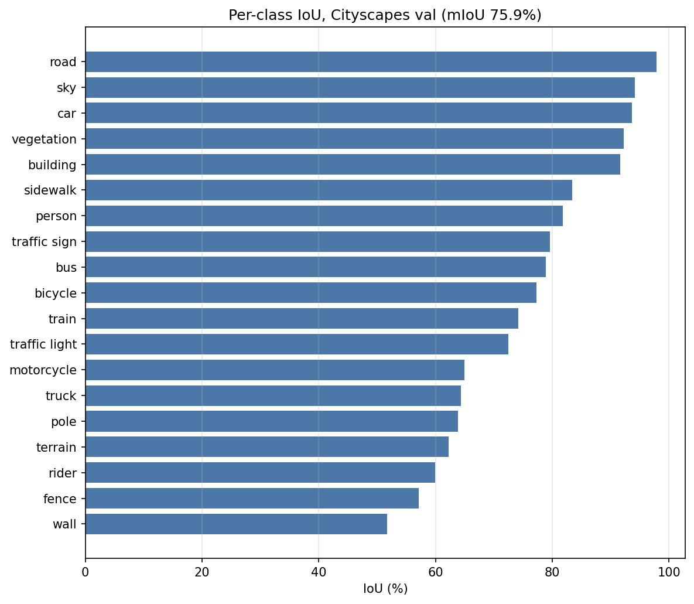
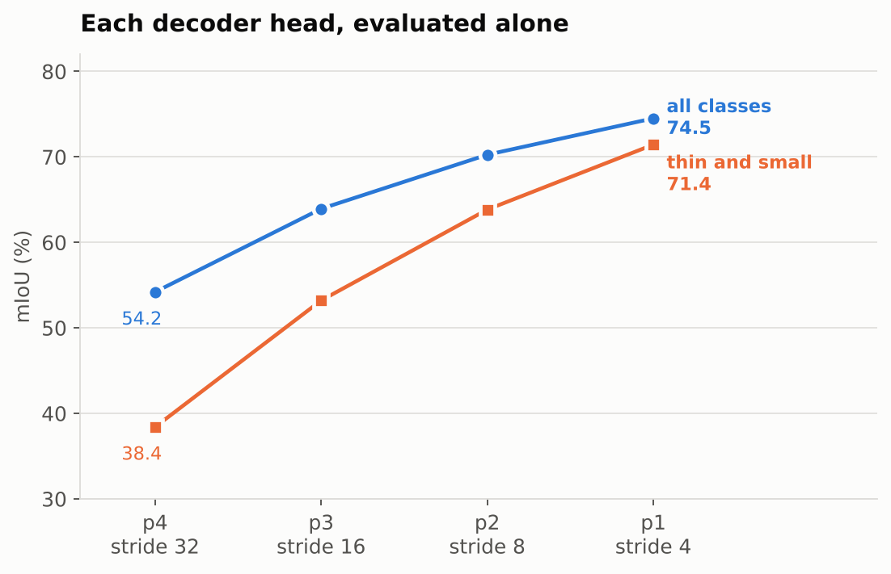
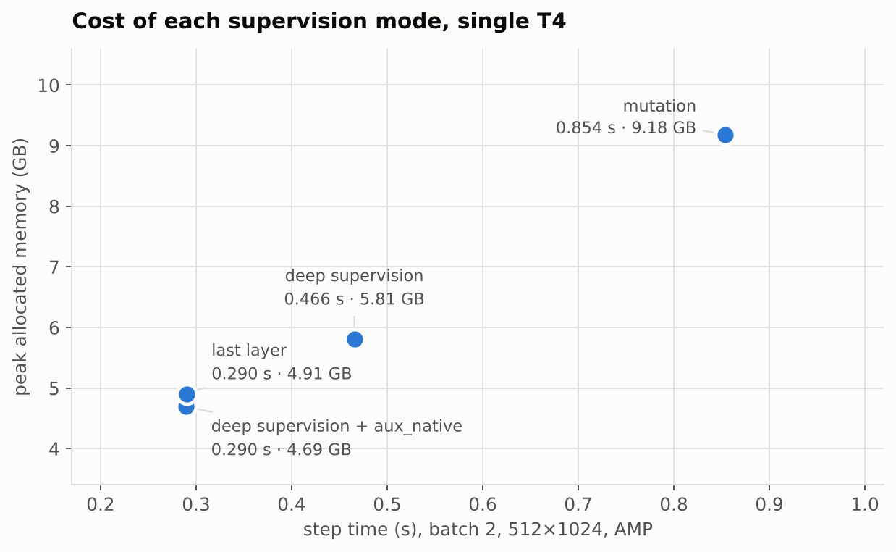
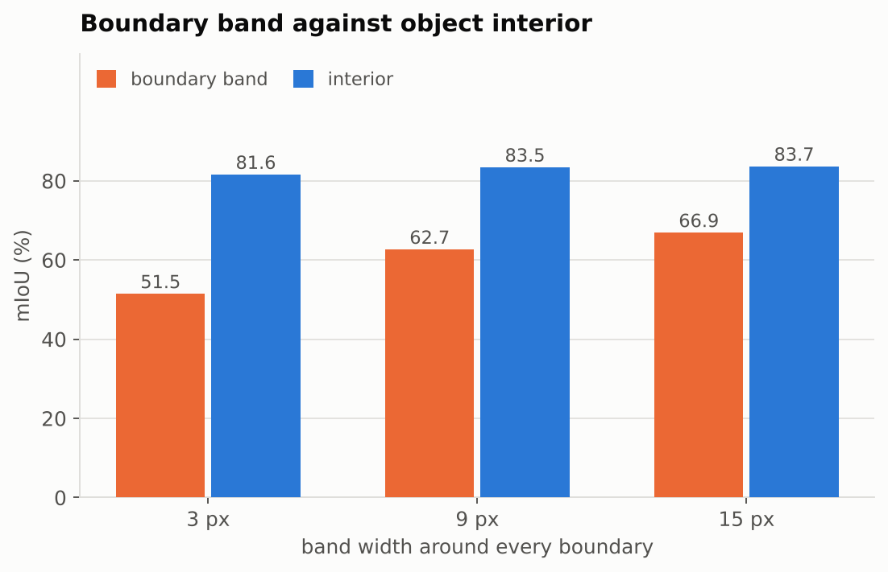
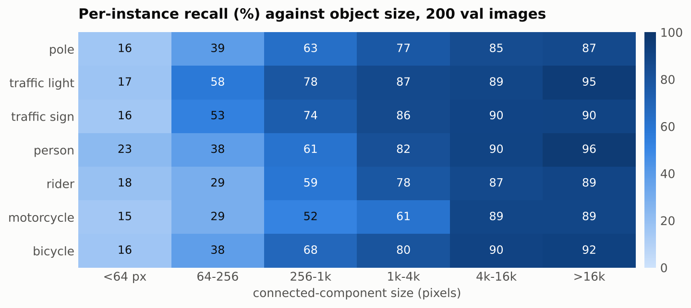

# EMCAD → Cityscapes: 19-class semantic segmentation

Adaptation of the official **EMCAD** decoder (Rahman, Munir & Marculescu,
*EMCAD: Efficient Multi-scale Convolutional Attention Decoding for Medical
Image Segmentation*, CVPR 2024 — [paper](https://arxiv.org/abs/2405.06880),
[code](https://github.com/SLDGroup/EMCAD)) to 19-class semantic segmentation on
Cityscapes, with a reproducible training/evaluation pipeline, efficiency
profiling, and a failure analysis focused on small and thin classes.

The EMCAD architecture in `lib/` is **vendored unmodified** from
SLDGroup/EMCAD @ `26c9c31f731f749b62c5fe83f44376dac75f3aa8`. Verify:

```bash
git clone --depth 1 https://github.com/SLDGroup/EMCAD.git /tmp/EMCAD_ref
diff -r --strip-trailing-cr lib /tmp/EMCAD_ref/lib    # expect no output
```

`--strip-trailing-cr` is needed because upstream's `lib/networks.py` is
committed with CRLF line endings; the file contents are byte-identical
otherwise.

---

## 1. Objective

EMCAD was published for binary medical image segmentation. This work takes
the decoder unchanged and asks what it does on 19-class urban scenes, where
the classes of interest are often a few pixels wide. The pipeline here trains
a PVTv2-B2 encoder with the EMCAD decoder on Cityscapes `train`, evaluates on
the 500-image `val` split at native 1024×2048 with a single confusion matrix
over the whole split, and reports per-class IoU, mIoU, peak GPU memory and
training step time alongside a failure analysis of the thin classes —
boundary-band accuracy, per-instance recall against object size, and the
contribution of each of the four decoder heads.

## 2. Architecture adaptation

EMCAD required **no architectural rewrite** for multiclass segmentation.
`num_classes` enters `EMCADNet.__init__` (`lib/networks.py:11`) and is consumed
at exactly four lines, 83–86, as the output channels of four 1×1 heads:

```python
self.out_head4 = nn.Conv2d(channels[0], num_classes, 1)   # 512 -> 19
self.out_head3 = nn.Conv2d(channels[1], num_classes, 1)   # 320 -> 19
self.out_head2 = nn.Conv2d(channels[2], num_classes, 1)   # 128 -> 19
self.out_head1 = nn.Conv2d(channels[3], num_classes, 1)   #  64 -> 19
```

The PVTv2-B2 encoder, the decoder's feature channels `[512,320,128,64]`, and
every attention module (CAB, SAB, LGAG, MSCB) are independent of the class
count. Measured: the four heads hold **19,532** of **26,782,915** parameters,
so moving from Synapse's 9 classes to 19 changes **10,280 parameters (0.04%)**.

`forward` returns four full-resolution logit maps `[B,19,H,W]`; evaluation uses
`P[-1]` (the finest head), matching the official EMCAD inference path
(`utils/utils.py:268`).

One input constraint: the fixed `scale_factor` upsampling at
`lib/networks.py:107-110` requires H and W divisible by 32. A non-divisible
crop raises a `RuntimeError` inside the decoder rather than failing silently.

The substantive work was the **task pipeline**: dataset and label handling,
ignore-index correctness in both losses and the metric, confusion-matrix
evaluation, profiling and visualization. See `MANUAL.md` §5.

## 3. Cityscapes label handling

- Masks are read from `*_gtFine_labelTrainIds.png` when present and from
  `*_gtFine_labelIds.png` otherwise. The official `gtFine_trainvaltest.zip`
  ships only the latter — `labelTrainIds` comes from
  `cityscapesscripts/preparation/createTrainIdLabelImgs.py`, which was not
  run — so this run read `labelIds` and mapped them at load time. The loader
  records which flavour it found in `Cityscapes.mask_kind` rather than
  assuming, and raises if any image has no matching mask at all.
- The 34 labelIds map to 19 trainIds (0–18) through a 256-entry lookup table
  built from `utils/cityscapes_labels.py`; every id with trainId −1, and
  every id absent from the table, becomes **255** and contributes to neither
  the loss nor the IoU. 11.3% of training pixels are 255.
- `utils/cityscapes_labels.py` reproduces the official table from
  `cityscapesscripts/helpers/labels.py`.
  `verify_against_cityscapesscripts()` re-checks it entry by entry against
  the installed package and reports any disagreement; with the package
  absent it reports that instead of silently passing. `tools/check_env.py`
  and `tests/test_dataset.py` both call it.
- Images use bilinear interpolation and masks nearest-neighbour, everywhere
  and under one shared random draw per sample, so geometry stays aligned.
  Crops smaller than the target are padded on the right and bottom: the
  image with the ImageNet mean colour, the mask with 255 — never class 0,
  which would otherwise invent road pixels at the border.
- `tools/make_train_ids.py` writes `labelTrainIds` files to disk for users
  who want the official flavour. It is not part of the pipeline that
  produced §7.

## 4. Environment

| | |
|---|---|
| GPU | NVIDIA Tesla T4, 15 GB (single card used) |
| Driver | 580.178.04 |
| PyTorch | 2.11.0+cu128 |
| CUDA | 12.8 |
| Platform | Kaggle Notebook, T4 ×2 accelerator |

Install: `pip install -r requirements.txt`. `lib/` is already vendored here
unmodified from the official repository; see the verification command at the
top of this file.

## 5. Exact commands

```bash
# gates
python -m tools.check_env
python -m tests.test_model_smoke --crop 512 1024 --batch 2 --amp
python -m tests.test_dataset --data-root $ROOT
python -m tests.test_metrics && python -m tests.test_losses
python -m tools.tiny_overfit --data-root $ROOT --images 12 --iters 300 --amp
python -m tools.supervision_cost --crop 512 1024 --batch 2 --amp

# primary experiment
python -W ignore train_cityscapes.py --config configs/cityscapes_pvtv2b2.yaml \
    --data-root $ROOT --out-dir runs/primary

# evaluation, figures, analysis
python -W ignore eval_cityscapes.py --checkpoint runs/primary/best_miou.pth \
    --data-root $ROOT --out-dir results --save-preds results/preds_trainids
python -W ignore visualize_cityscapes.py --checkpoint runs/primary/best_miou.pth \
    --data-root $ROOT --num-images 8 --strategy spread
python -m tools.analyze_failures
```

## 6. Experimental configuration

| Item | Value |
|---|---|
| Encoder | PVTv2-B2, ImageNet pretrained, 332 tensors matched |
| Decoder | EMCAD, unmodified |
| Classes / ignore index | 19 / 255 |
| Train crop | 512×1024 |
| Augmentation | random scale 0.5–1.25, random crop, horizontal flip, colour jitter |
| Validation resolution | native 1024×2048 |
| Batch size | 4 (no gradient accumulation) |
| Optimizer | AdamW, lr 6e-5, weight decay READ FROM logs/config.json |
| Schedule | 10,500 iterations, poly power 0.9, 500 warmup |
| Loss | `0.3·CE(ignore_index=255) + 0.7·masked multiclass Dice` |
| Supervision | deep_supervision with auxiliary heads at native stride (4 loss terms) |
| AMP | on, fp16 autocast, loss computed in fp32 |
| Devices | single T4 (`CUDA_VISIBLE_DEVICES=0`); DataParallel measured 4.1× slower |
| Seed | READ FROM logs/config.json, `cudnn.deterministic=True` |
| Epochs | 14.1 (10,500 × 4 = 42,000 images / 2,975) |
| Wall clock | 2.153 h, exit code 0 |

### Deviations from official EMCAD defaults

| Deviation | Reason |
|---|---|
| Supervision `deep_supervision` instead of `mutation` | measured: 0.2897 s and 4.692 GB against 0.8536 s and 9.184 GB at batch 2 (see §7) |
| Masked Dice replaces `utils/utils.py:DiceLoss` | the original counts ignored pixels in its denominator (`MANUAL.md` §9) |
| `CrossEntropyLoss(ignore_index=255)` | the original has no ignore index and raises on 255 |
| Poly LR reinstated | commented out at `trainer.py:118`; standard for Cityscapes |
| AMP enabled | memory headroom at 512×1024 |
| Iteration-based schedule + resume | bounded GPU sessions |

## 7. Results

### Overall

| Metric | Value |
|---|---|
| **mIoU (19 classes)** | **75.86 %** |
| Pixel accuracy | 95.70 % |
| Classes counted | 19 / 19 |
| Evaluated head | `P[-1]` (finest, stride 4) |
| Validation images | 500, native 1024×2048, no test-time augmentation |
| Schedule | 10,500 iterations = 14.1 epochs |

### Per-class IoU



Exact values, with train pixel share per class, in
[`results/RESULTS.md`](results/RESULTS.md).

### Supplementary grouping (does **not** affect the mIoU above)

| Group | Mean IoU (%) | Mean train pixel share (%) |
|---|---|---|
| Large regions (road, sidewalk, building, vegetation, terrain, sky) | 86.95 | 14.37 |
| Medium objects (wall, fence, car, truck, bus, train) | 69.97 | 1.48 |
| Small / thin (pole, traffic light, traffic sign, person, rider, motorcycle, bicycle) | 71.41 | 0.67 |

### Per-head evaluation (200-image subset)



| Head | Stride | mIoU % | Large % | Small / thin % |
|---|---|---|---|---|
| P4 | 32 | 54.20 | 71.85 | 38.40 |
| P3 | 16 | 63.94 | 78.28 | 53.21 |
| P2 | 8 | 70.26 | 81.96 | 63.84 |
| **P1** | **4** | **74.51** | **84.35** | **71.44** |

Monotonic in resolution. Summing all four heads at inference, which the
upstream code offers, costs 6.3 points: 69.59 % against 75.86 %, and
60.05 % against 71.41 % on the thin classes. `P[-1]` alone is reported.

### Efficiency

| Measurement | Value |
|---|---|
| Parameters, total | 26.78 M |
| Encoder / decoder / heads | 24.85 M / 1.913 M / 19.5 K |
| Decoder vs published | 1.913 M vs 1.91 M |
| Peak GPU memory (allocated), training | 8.905 GiB |
| Peak GPU memory (allocated / reserved), benchmark | 4.692 / 5.025 GiB |
| Mean training step time, logged | 0.546 s (batch 4, 512×1024, AMP) |
| Mean training step time, compute only | 0.2897 s (batch 2, synthetic data) |
| Inference, 1024×2048 | 0.4863 s |
| Inference, 512×1024 | 0.0546 s |
| Training wall clock | 2.153 h for 10,500 iterations |

**Step time is defined as** forward + loss + backward + optimizer.step +
zero_grad, measured with `torch.cuda.synchronize()` immediately before starting
and immediately after finishing the timed GPU work, median over the timed
iterations after warm-up, excluding dataloading and validation.

### Supervision mode cost (batch 2, 512×1024, synthetic data)



Four loss terms for the cost of one: keeping the auxiliary heads at native
decoder stride matches `last_layer` to within 0.4 ms. Upsampling them to full
resolution first costs 61 % more time; MUTATION's 15 subsets cost 2.9× the time
and 2.0× the memory.

## 8. Qualitative results

`results/qualitative/` — 8 validation scenes, each as two files.

`<name>.png` stacks four full-resolution panels vertically: input RGB,
ground truth blended over the input, prediction blended over the input, and
an error map, with a class legend for the classes present in that scene.
Error map: grey ignored, white correct, red thin-class false positive, blue
thin-class false negative, orange other confusion.


`<name>_thincrop.png` is the same scene cropped to the window containing the
most thin-class pixels, found by an integral-image scan. A 1024×2048 panel
reproduced at page width makes a 3-pixel pole invisible, so the crops are
what carry the failure-mode argument and the full panels establish context.


The images above are downscaled copies in `results/qualitative/`, so the page
loads; the full-resolution originals are in `results/qualitative/`.

Scene selection is recorded in `results/qualitative/scene_selection.json`: ranked by
number of distinct classes present, then by thin-class pixel count. Six dense
scenes (`dense_0`–`dense_5`, 16 classes each) and two sparse ones
(`easy_6`, `easy_7`, 3 classes each) are included, so the figures are not
only the crowded cases.

`results/sanity/` holds five prediction overlays written during training as a
mid-run check.

## 9. Failure analysis

Three measurements, each on a 200-image subset of the validation split.

**Error concentrates at boundaries.** Restricting the metric to a band of
width *k* around every ground-truth boundary, and separately to object
interiors:



| Band width | Band mIoU % | Interior mIoU % | Band, thin classes % | Interior, thin % |
|---|---|---|---|---|
| 3 px | 51.50 | 81.63 | 53.15 | 83.27 |
| 9 px | 62.71 | 83.47 | 64.63 | 84.57 |
| 15 px | 66.94 | 83.70 | 68.15 | 83.30 |

A 30-point gap at 3 pixels, closing steadily as the band widens. This is
consistent with a model that localises objects correctly and loses their
edges, which is the expected signature of a prediction made at stride 4 and
bilinearly upsampled. Part of this gap is metric geometry rather than model
failure: a fixed boundary error of *n* pixels removes a far larger fraction of
a 4-pixel-wide pole than of a building facade, so IoU penalises thin classes
more for the same absolute error.

**Recall is a sharp function of instance size.** Per-connected-component
recall, thin classes:



Every class lies between 15.0 % and 22.7 % on components under 64 pixels and
between 86.9 % and 96.3 % above 16k, and the seven curves are close to
parallel in between. The classes differ sharply in appearance — a pole is a
vertical line, a sign a compact blob, a person an articulated shape — and what
they share is pixel count, which suggests the limit is the output stride
rather than anything class-specific.

**Residual confusions are semantic rather than spatial.** Pole is absorbed by
building in 12.0 % of its ground-truth pixels, rider by person in 8.0 %, and
motorcycle by bicycle in 4.2 %. These are confusions between genuinely
similar categories — a rider is a person, a motorcycle resembles a bicycle —
rather than thin objects being absorbed into whatever surrounds them.

**Road / sidewalk.** Road reaches 97.89 % and sidewalk 83.44 %; the 14-point
gap is consistent with the shared, often unmarked boundary between them, where
the trimap result above locates most of the remaining error.

**The weakest classes are not resolution-limited.** Wall (51.73 %), fence
(57.09 %) and terrain (62.29 %) lose more ground truth to a single wrong class
than any thin class does: wall gives 21.5 % of its pixels to building, fence
17.0 % to building, and terrain 18.1 % to vegetation. All three are large and
flat and share texture and position with the class that absorbs them, so a
finer output stride would not help them. A longer schedule and class-balanced
sampling plausibly would.

## 10. Validation of the evaluation code

- `tests/test_metrics.py` — 8 unit tests (perfect, all-wrong, two-class swap,
  all-ignore, mixed ignore, absent classes, hand-computed case, accumulation).
- `tests/test_losses.py` — ignore-invariance, zero gradient at ignored pixels,
  and a numerical demonstration that the original EMCAD Dice responds to
  ignored-region logits while the masked version does not.
- `tests/test_dataset.py` — 8 dataset checks plus manual overlay inspection.
- Official-evaluator cross-check: not run. `tools/official_eval_crosscheck.py`
  is in place but the official `cityscapesScripts` evaluator needs the
  `labelTrainIds` ground truth written to disk and a separate pass over the
  split. The metric here is validated instead by the eight unit tests above, including a hand-computed case and
  exact 1.000000 mIoU on ground truth.

## 11. Reproducibility

Seeds fixed for `random`, `numpy`, `torch`, CUDA and dataloader workers;
`cudnn.deterministic=True`; configuration dumped to `runs/<exp>/config.json`
and embedded in every checkpoint.

Caveats, stated rather than glossed: resuming does not restore dataloader
shuffling or RNG state, so a run completed across several sessions is not
bit-identical to an uninterrupted one; and results are not expected to be
bit-identical across GPU models or PyTorch versions.


## Attribution

Architecture and the `lib/` directory: [SLDGroup/EMCAD](https://github.com/SLDGroup/EMCAD),
© its authors, used under its license (see `LICENSE`, `NOTICE`). The training
loop, loss and dataset code here derive from that repository's
`trainer.py`, `utils/utils.py` and `utils/dataset_synapse.py`; each file names
the source lines it derives from.

```bibtex
@inproceedings{rahman2024emcad,
  title={EMCAD: Efficient multi-scale convolutional attention decoding for medical image segmentation},
  author={Rahman, Md Mostafijur and Munir, Mustafa and Marculescu, Radu},
  booktitle={Proceedings of the IEEE/CVF Conference on Computer Vision and Pattern Recognition},
  pages={11769--11779},
  year={2024}
}
```
